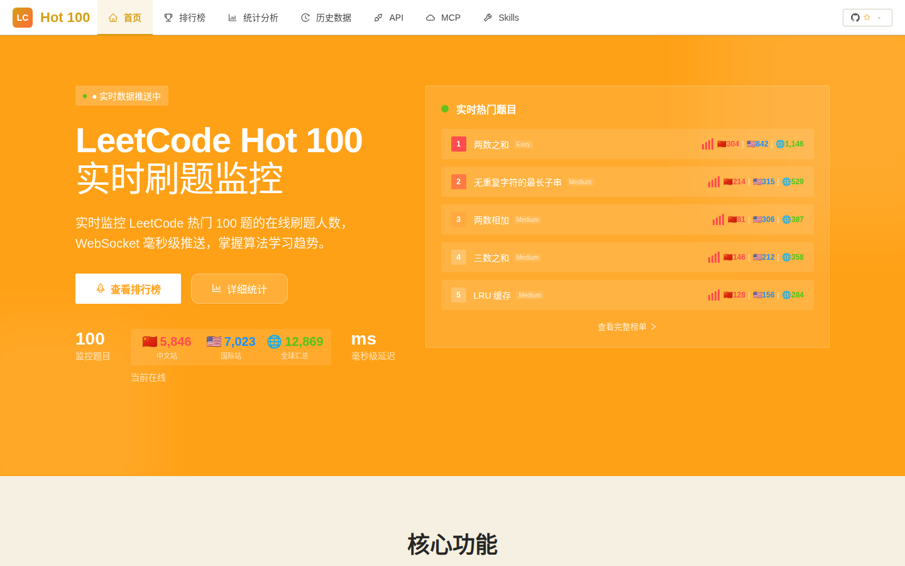
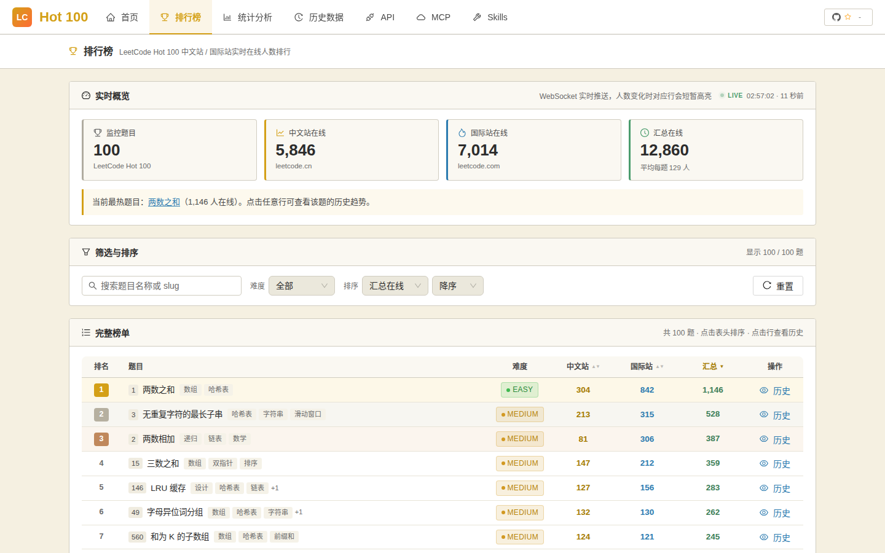
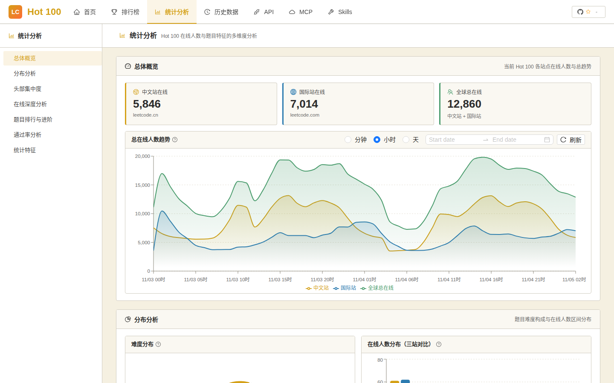
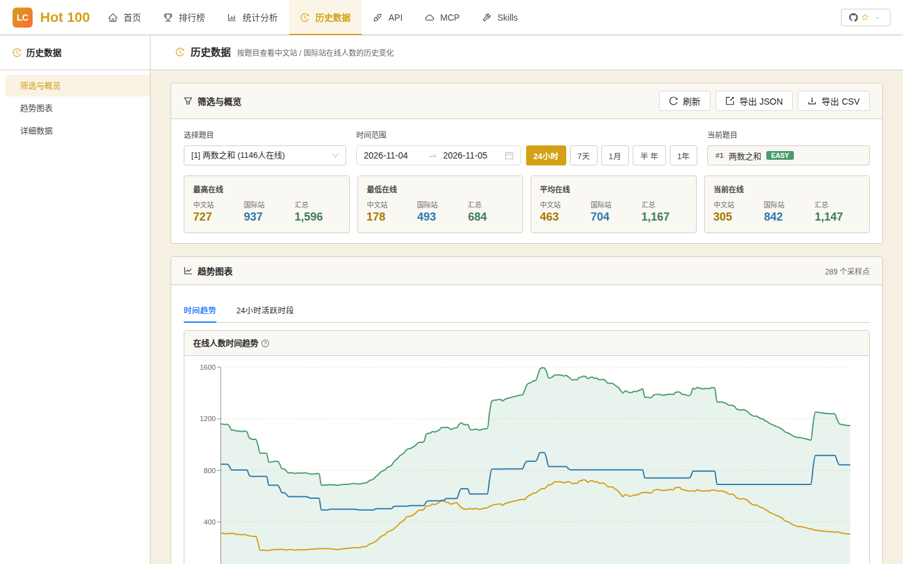
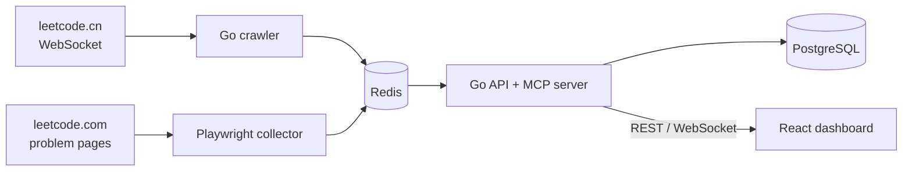

# LeetCode Hot 100 Dashboard

**English** | [简体中文](README.zh-CN.md)

> Real-time online activity for LeetCode's Hot 100 — across both **leetcode.cn** and **leetcode.com**.

[](https://leetcode.zhaixingren.cn)
[](LICENSE)
[](backend/go.mod)
[](frontend/package.json)
[](frontend/tsconfig.json)
[](deploy/leetcode-001/docker-compose.yml)
[](https://leetcode.zhaixingren.cn/mcp-docs)

[Live Demo](https://leetcode.zhaixingren.cn) · [REST API Docs](https://leetcode.zhaixingren.cn/api-docs) · [MCP Docs](https://leetcode.zhaixingren.cn/mcp-docs)

## Screenshots

| Home | Rankings |
| --- | --- |
|  |  |
| **Statistics** | **History** |
|  |  |

## Overview

LeetCode Hot 100 Dashboard answers a simple question: **how many people are solving each Hot 100 problem right now?**

A Go service subscribes to LeetCode's collaboration WebSocket, stores each sample in PostgreSQL, keeps the latest values in Redis, and pushes changes to the React dashboard over WebSocket. The same dataset is available through a REST API and a read-only **Model Context Protocol (MCP)** server, so AI clients can query it directly.

| Site | Collection method | Refresh |
| --- | --- | --- |
| leetcode.cn | Native WebSocket subscription | ~30 s |
| leetcode.com | Real-browser collector (Playwright); Cloudflare blocks plain WebSocket clients | ~30 s per cycle |

## Features

- **Live leaderboard** — CN, COM and combined online counts for all Hot 100 problems, with live row highlighting and sortable columns.
- **Historical trends** — per-problem history with site filters, custom time ranges, automatic aggregation and CSV/JSON export.
- **Statistics** — difficulty mix, online-count distribution, head concentration (Pareto / Gini), peak hours, acceptance rates and topic rankings.
- **Search & filtering** — by problem name, slug, difficulty and topic tags; sort preferences persist locally.
- **REST API** — documented endpoints with a consistent `code/msg/data` envelope and Redis-backed caching.
- **MCP server** — four read-only tools for Claude Desktop, Cursor, Cline and other MCP-compatible clients.
- **Production-ready deployment** — Docker Compose with PostgreSQL, Redis, backend, crawler and nginx frontend, plus health checks.
- **Rate limiting & caching** — Redis sliding-window limiter for origin requests; cache hits do not consume quota.

## Architecture



- **Redis** holds the latest CN/COM/unified counts, pub/sub update events, API response cache and rate-limit buckets.
- **PostgreSQL** stores problem metadata and the full history used by the charts and export endpoints.
- The frontend receives an initial snapshot from the REST API and then keeps rows fresh over `/ws`.

## Tech stack

| Layer | Stack |
| --- | --- |
| Backend | Go 1.25, Gin, GORM, gorilla/websocket, mcp-go |
| Data | PostgreSQL 16, Redis 7 |
| Frontend | React 18, TypeScript 5, Vite 5, Ant Design 5, Recharts |
| COM collector | Node.js, Playwright Chromium |
| Deployment | Docker Compose, nginx |

## Getting started

### Docker Compose (recommended)

The compose file in `deploy/leetcode-001/` runs the complete stack: PostgreSQL, Redis, backend, crawler and the nginx-served frontend. PostgreSQL and Redis data are bind-mounted to the host so container rebuilds do not lose history.

```bash
git clone https://github.com/fuck-algorithm/leetcode-online-dashboard.git
cd leetcode-online-dashboard

# Build the three application images locally
docker build -t leetcode-dashboard-backend:latest backend
docker build -f backend/Dockerfile.crawler -t leetcode-dashboard-crawler:latest backend
docker build -t leetcode-dashboard-frontend:latest frontend

cd deploy/leetcode-001
cat > .env <<'EOF'
POSTGRES_USER=leetcode_dashboard
POSTGRES_PASSWORD=change-me
POSTGRES_DB=leetcode_dashboard
FRONTEND_PORT=8080
EOF
docker compose up -d
```

Open `http://localhost:8080`. The backend seeds the Hot 100 list and starts collecting CN data automatically.

> The COM collector is optional and runs outside the compose stack. It needs a real browser and a non-datacenter network to pass Cloudflare; see [`com-collector/`](com-collector/). Without it, CN data works and COM counts remain zero.

### Local development

Prerequisites: Go 1.25+, Node.js 18+, PostgreSQL and Redis.

```bash
# 1. Configure the backend
cp .env.example .env
# Set DB_HOST/DB_PORT/DB_USER/DB_PASSWORD/DB_NAME and REDIS_HOST/REDIS_PORT
# to your local services (defaults in the example point at a shared cluster).

# 2. Backend — http://localhost:52106
cd backend
go mod download
go run ./cmd/main.go

# 3. Frontend — http://localhost:52107
cd frontend
npm ci
npm run dev
```

Build the frontend for production with `npm run build` (TypeScript check + Vite build).

## Configuration

The backend reads a `.env` file from the repository root (real environment variables take precedence). Key options:

| Variable | Default | Description |
| --- | --- | --- |
| `PORT` | `52106` | HTTP listen port |
| `DB_HOST` / `DB_PORT` | `localhost` / `5432` | PostgreSQL endpoint |
| `DB_USER` / `DB_PASSWORD` / `DB_NAME` | — | PostgreSQL credentials |
| `REDIS_HOST` / `REDIS_PORT` | `localhost` / `6379` | Redis endpoint |
| `REDIS_KEY_PREFIX` | `leetcode-dashboard:` | Namespace for all keys and pub/sub channels |
| `INTERVAL_SEC` | `30` | Collection interval |
| `BATCH_SIZE` | `10` | Problems per WebSocket batch |
| `CRAWL_COM` | `false` | Let the Go crawler connect directly to leetcode.com |
| `API_CACHE_TTL_SECONDS` | `30` | REST response cache TTL |
| `RATE_LIMIT_PER_MINUTE` | `300` | Max origin requests per IP per minute |
| `REDIS_POOL_SIZE` | `20` | Redis connection pool size |

See [`.env.example`](.env.example) for the full list, including collector tuning options.

## API

All responses use a `{"code":200,"msg":"success","data":…}` envelope. Errors return `{"code":<status>,"message":…}`.

| Method | Endpoint | Description |
| --- | --- | --- |
| `GET` | `/api/health` | Health check |
| `GET` | `/api/hot100` | Hot 100 with CN/COM/total online counts |
| `GET` | `/api/hot100/problems` | Problem metadata |
| `GET` | `/api/hot100/online-counts/:id` | History for one problem (`limit`, `startTime`, `endTime`, `site`) |
| `GET` | `/api/hot100/online-counts/latest` | Latest counts for every problem |
| `GET` | `/api/hot100/statistics` | Aggregate statistics |
| `GET` | `/api/hot100/peaks` | Detected peak online times |
| `GET` | `/api/hot100/export?format=csv\|json` | Export history |
| `GET` | `/api/total-online-aggregate` | Total-online time series (`granularity=minute\|hour\|day`, `start`, `end`, `site`) |
| `WS` | `/ws` | Real-time batch updates |

Example:

```bash
curl https://leetcode.zhaixingren.cn/api/hot100
```

### WebSocket

Connect to `wss://<host>/ws` to receive `batch_update` messages containing the latest problems and their CN/COM/total counts. The dashboard uses these messages to update rows without polling.

## MCP

The server exposes a read-only MCP endpoint at `POST /mcp` (Streamable HTTP), with legacy SSE endpoints at `/mcp/sse` and `/sse`.

```json
{
  "mcpServers": {
    "leetcode-dashboard": {
      "type": "streamable-http",
      "url": "https://leetcode.zhaixingren.cn/mcp"
    }
  }
}
```

| Tool | Description | Parameters |
| --- | --- | --- |
| `get_hot100_problems` | Full Hot 100 list with metadata and online counts | none |
| `get_hot100_online_count` | Latest online counts for the Hot 100 | none |
| `get_problem_online_count` | Latest count for one problem | `problem_id` (number or slug) |
| `get_problem_history` | Historical counts for one problem | `problem_id`, `limit` |

All tools are annotated read-only and idempotent. See the [interactive MCP guide](https://leetcode.zhaixingren.cn/mcp-docs) for client setup and examples.

## Project layout

```text
backend/              Go API server, WebSocket worker, crawler and MCP tools
frontend/             React + TypeScript single-page dashboard
com-collector/        Playwright-based collector for leetcode.com
deploy/leetcode-001/  Docker Compose deployment and helper scripts
docs/screenshots/     README screenshots
```

## Deployment

The production deployment builds the backend/crawler/frontend images locally, transfers them with `docker save`, and starts the compose stack:

```bash
deploy/leetcode-001/deploy-online.sh              # build → upload → start → verify
deploy/leetcode-001/deploy-online.sh --skip-build # redeploy with existing images
```

See [`deploy/leetcode-001/README.md`](deploy/leetcode-001/README.md) for the full topology and first-deploy notes.

## Contributing

Issues and pull requests are welcome. Before submitting:

```bash
cd frontend && npm run build
cd backend && go test ./...
```

Please keep README examples free of credentials and private infrastructure details.

## License

[Apache License 2.0](LICENSE)

This is an unofficial community project. It is not affiliated with LeetCode. LeetCode and related marks belong to their respective owners.
