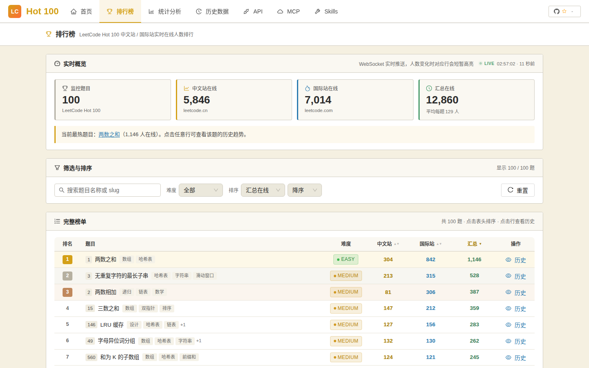
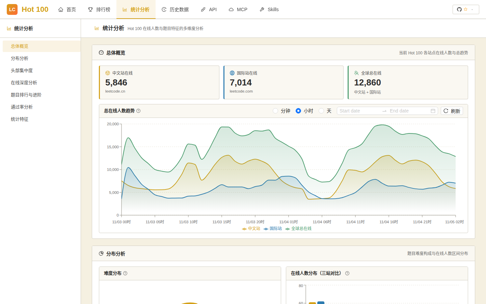
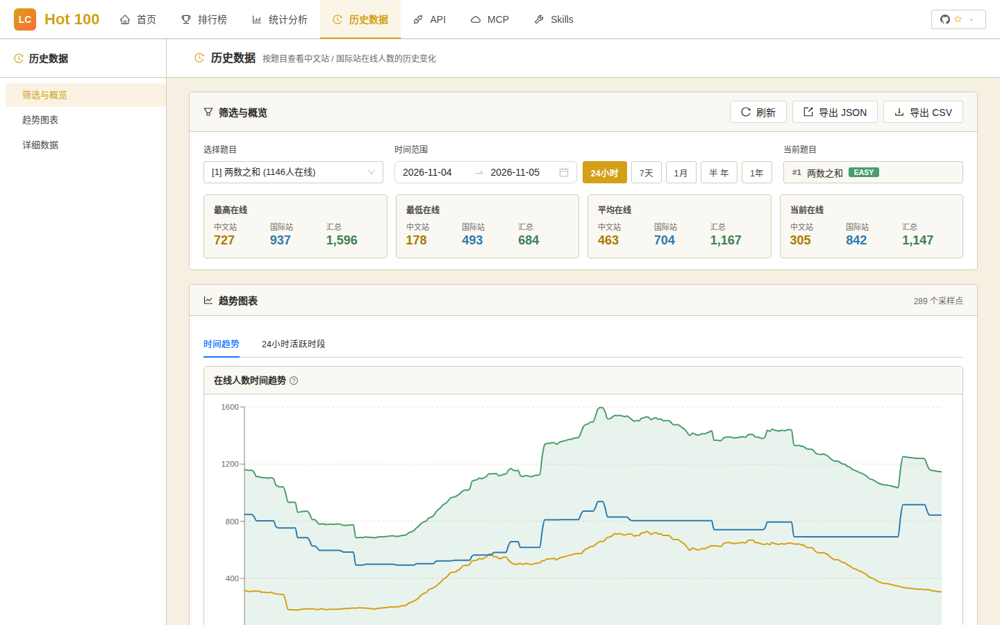
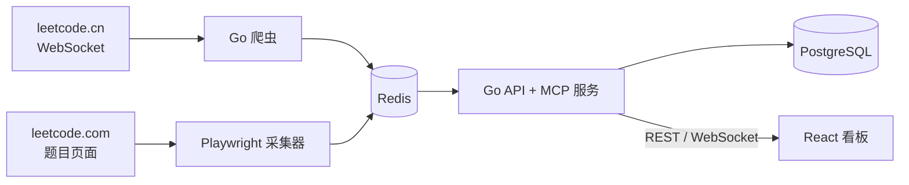

# LeetCode Hot 100 Dashboard

[English](README.md) | **简体中文**

> 实时追踪 LeetCode Hot 100 在 **leetcode.cn** 与 **leetcode.com** 的在线刷题人数。

[](https://leetcode.zhaixingren.cn)
[](LICENSE)
[](backend/go.mod)
[](frontend/package.json)
[](frontend/tsconfig.json)
[](deploy/leetcode-001/docker-compose.yml)
[](https://leetcode.zhaixingren.cn/mcp-docs)

[在线演示](https://leetcode.zhaixingren.cn) · [REST API 文档](https://leetcode.zhaixingren.cn/api-docs) · [MCP 文档](https://leetcode.zhaixingren.cn/mcp-docs)

## 页面截图

| 首页 | 排行榜 |
| --- | --- |
|  |  |
| **统计分析** | **历史数据** |
|  |  |

## 项目简介

LeetCode Hot 100 Dashboard 只回答一个问题：**此刻每道 Hot 100 题目有多少人在线刷题？**

Go 服务订阅 LeetCode 的协作 WebSocket，把每次采样写入 PostgreSQL，将最新值保存在 Redis，并通过 WebSocket 推送给 React 看板。同一份数据同时通过 REST API 和只读的 **Model Context Protocol（MCP）** 服务对外提供，AI 客户端可以直接查询。

| 站点 | 采集方式 | 刷新频率 |
| --- | --- | --- |
| leetcode.cn | 原生 WebSocket 订阅 | 约 30 秒 |
| leetcode.com | 真实浏览器采集器（Playwright）；Cloudflare 会拦截普通 WebSocket 客户端 | 每轮约 30 秒 |

## 功能

- **实时排行榜** —— 100 道题的中文站、国际站和汇总在线人数，人数变化时行内高亮，支持表头排序。
- **历史趋势** —— 按题目查看历史曲线，支持站点筛选、自定义时间范围、自动聚合和 CSV/JSON 导出。
- **统计分析** —— 难度构成、在线人数分布、头部集中度（帕累托 / 基尼系数）、高峰时段、通过率和标签排行。
- **搜索与筛选** —— 按题名、slug、难度、题目标签过滤，排序偏好本地持久化。
- **REST API** —— 接口文档齐全，统一使用 `code/msg/data` 响应结构，带 Redis 响应缓存。
- **MCP 服务** —— 4 个只读工具，可接入 Claude Desktop、Cursor、Cline 等 MCP 客户端。
- **可部署** —— Docker Compose 一键拉起 PostgreSQL、Redis、后端、爬虫和 nginx 前端，全部带健康检查。
- **限流与缓存** —— Redis 滑动窗口限流；缓存命中不消耗配额，能撑住突发读流量。

## 架构



- **Redis** 保存最新的中文站、国际站和汇总人数，以及更新事件、API 响应缓存和限流计数。
- **PostgreSQL** 保存题目元数据和完整历史数据，供图表与导出接口使用。
- 前端先通过 REST API 获取初始快照，之后通过 `/ws` 保持实时更新。

## 技术栈

| 层级 | 技术 |
| --- | --- |
| 后端 | Go 1.25、Gin、GORM、gorilla/websocket、mcp-go |
| 数据 | PostgreSQL 16、Redis 7 |
| 前端 | React 18、TypeScript 5、Vite 5、Ant Design 5、Recharts |
| 国际站采集 | Node.js、Playwright Chromium |
| 部署 | Docker Compose、nginx |

## 快速开始

### Docker Compose（推荐）

`deploy/leetcode-001/` 下的 compose 文件会启动完整技术栈：PostgreSQL、Redis、后端、爬虫和 nginx 前端。PostgreSQL 与 Redis 数据通过 bind mount 落在宿主机磁盘上，容器重建不会丢历史数据。

```bash
git clone https://github.com/fuck-algorithm/leetcode-online-dashboard.git
cd leetcode-online-dashboard

# 在本地构建三个应用镜像
docker build -t leetcode-dashboard-backend:latest backend
docker build -f backend/Dockerfile.crawler -t leetcode-dashboard-crawler:latest backend
docker build -t leetcode-dashboard-frontend:latest frontend

cd deploy/leetcode-001
cat > .env <<'EOF'
POSTGRES_USER=leetcode_dashboard
POSTGRES_PASSWORD=change-me
POSTGRES_DB=leetcode_dashboard
FRONTEND_PORT=8080
EOF
docker compose up -d
```

打开 `http://localhost:8080`。后端会自动初始化 Hot 100 题目列表并开始采集中文站数据。

> 国际站采集器是可选的，不包含在 compose 中。它需要真实浏览器和非机房网络才能通过 Cloudflare，用法见 [`com-collector/`](com-collector/)。不启动它时中文站数据正常，国际站人数保持为 0。

### 本地开发

前置依赖：Go 1.25+、Node.js 18+、PostgreSQL、Redis。

```bash
# 1. 配置后端
cp .env.example .env
# 把 DB_HOST/DB_PORT/DB_USER/DB_PASSWORD/DB_NAME 和 REDIS_HOST/REDIS_PORT
# 改成你本机的服务地址（示例文件默认指向共享集群）。

# 2. 后端 —— http://localhost:52106
cd backend
go mod download
go run ./cmd/main.go

# 3. 前端 —— http://localhost:52107
cd frontend
npm ci
npm run dev
```

生产构建：`npm run build`（TypeScript 检查 + Vite 构建）。

## 配置

后端会读取仓库根目录的 `.env`（真实环境变量优先）。常用配置：

| 变量 | 默认值 | 说明 |
| --- | --- | --- |
| `PORT` | `52106` | HTTP 监听端口 |
| `DB_HOST` / `DB_PORT` | `localhost` / `5432` | PostgreSQL 地址 |
| `DB_USER` / `DB_PASSWORD` / `DB_NAME` | — | PostgreSQL 凭据 |
| `REDIS_HOST` / `REDIS_PORT` | `localhost` / `6379` | Redis 地址 |
| `REDIS_KEY_PREFIX` | `leetcode-dashboard:` | 所有键和 pub/sub 通道的前缀 |
| `INTERVAL_SEC` | `30` | 采集间隔（秒） |
| `BATCH_SIZE` | `10` | 每批处理的 WebSocket 题目数 |
| `CRAWL_COM` | `false` | 是否让 Go 爬虫直连 leetcode.com |
| `API_CACHE_TTL_SECONDS` | `30` | REST 响应缓存时间 |
| `RATE_LIMIT_PER_MINUTE` | `300` | 单 IP 每分钟最大回源请求数 |
| `REDIS_POOL_SIZE` | `20` | Redis 连接池大小 |

完整配置（包含采集器参数）见 [`.env.example`](.env.example)。

## API

所有响应统一使用 `{"code":200,"msg":"success","data":…}`，错误返回 `{"code":<状态码>,"message":…}`。

| 方法 | 路径 | 说明 |
| --- | --- | --- |
| `GET` | `/api/health` | 健康检查 |
| `GET` | `/api/hot100` | Hot 100 及中文站、国际站、汇总在线人数 |
| `GET` | `/api/hot100/problems` | 题目元数据 |
| `GET` | `/api/hot100/online-counts/:id` | 单题历史（`limit`、`startTime`、`endTime`、`site`） |
| `GET` | `/api/hot100/online-counts/latest` | 所有题目的最新人数 |
| `GET` | `/api/hot100/statistics` | 汇总统计 |
| `GET` | `/api/hot100/peaks` | 在线人数高峰时段 |
| `GET` | `/api/hot100/export?format=csv\|json` | 导出历史数据 |
| `GET` | `/api/total-online-aggregate` | 总在线人数时间序列（`granularity=minute\|hour\|day`、`start`、`end`、`site`） |
| `WS` | `/ws` | 实时批量更新 |

示例：

```bash
curl https://leetcode.zhaixingren.cn/api/hot100
```

### WebSocket

连接 `wss://<host>/ws` 后会收到 `batch_update` 消息，包含所有题目的最新中文站、国际站和汇总人数。看板依靠这些消息更新表格，无需轮询。

## MCP

服务端在 `POST /mcp` 提供只读 MCP 接口（Streamable HTTP），同时保留旧式 SSE 端点 `/mcp/sse` 和 `/sse`。

```json
{
  "mcpServers": {
    "leetcode-dashboard": {
      "type": "streamable-http",
      "url": "https://leetcode.zhaixingren.cn/mcp"
    }
  }
}
```

| 工具 | 说明 | 参数 |
| --- | --- | --- |
| `get_hot100_problems` | Hot 100 完整列表（元数据 + 在线人数） | 无 |
| `get_hot100_online_count` | Hot 100 最新在线人数 | 无 |
| `get_problem_online_count` | 单题最新在线人数 | `problem_id`（题号或 slug） |
| `get_problem_history` | 单题历史在线人数 | `problem_id`、`limit` |

所有工具都标记为只读、幂等。客户端配置和更多示例见[交互式 MCP 文档](https://leetcode.zhaixingren.cn/mcp-docs)。

## 项目结构

```text
backend/              Go API 服务、WebSocket worker、爬虫和 MCP 工具
frontend/             React + TypeScript 单页看板
com-collector/        基于 Playwright 的 leetcode.com 采集器
deploy/leetcode-001/  Docker Compose 部署文件和辅助脚本
docs/screenshots/     README 截图
```

## 部署

生产部署会在本地构建后端 / 爬虫 / 前端镜像，用 `docker save` 传到服务器，再启动 compose：

```bash
deploy/leetcode-001/deploy-online.sh              # 构建 → 上传 → 启动 → 校验
deploy/leetcode-001/deploy-online.sh --skip-build # 用现有镜像重新部署
```

完整拓扑和首次部署步骤见 [`deploy/leetcode-001/README.md`](deploy/leetcode-001/README.md)。

## 参与贡献

欢迎提交 Issue 和 Pull Request。提交前请先确保：

```bash
cd frontend && npm run build
cd backend && go test ./...
```

README 中的示例请不要包含凭据和私有基础设施信息。

## 许可证

[Apache License 2.0](LICENSE)

本项目是非官方社区项目，与 LeetCode 官方无关联。LeetCode 及相关商标归其各自所有者所有。
